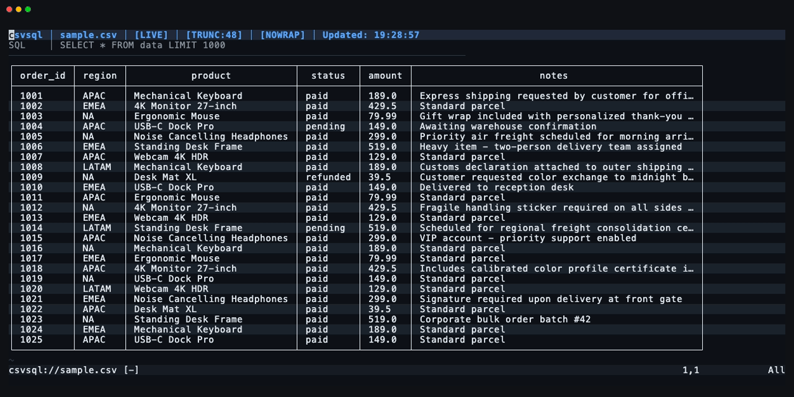

# csvsql.nvim

[](https://github.com/ga2631/csvsql.nvim/actions/workflows/ci.yml)
[](https://neovim.io/)
[](LICENSE)

**Read-only, live-updating CSV/TSV table viewer with full SQL support for Neovim — powered by [DuckDB](https://duckdb.org/).**



Open any `.csv` or `.tsv` file in Neovim and immediately inspect it as a crisp Unicode table, run real SQL queries against it (`WHERE`, `GROUP BY`, `ORDER BY`, `SUMMARIZE`, `JOIN`), and watch the table update in **real time** whenever the file changes on disk.

---

## Features

- **Auto-rendered read-only table** — Opens `.csv` / `.tsv` files in a safe `modifiable = false` view using DuckDB's Unicode box table. Never modifies or corrupts your underlying file.
- **Full SQL support** — Your CSV is exposed as a virtual table named `data`. Query via `:CsvSql <query>` or a toggleable multi-line SQL scratch split (`ft=sql`).
- **Real-time live reload** — Uses Neovim's native libuv watcher (`vim.uv.new_fs_event`) on the parent directory (handles atomic save/rename writes) with debouncing and viewport/cursor preservation.
- **Non-destructive error handling** — If a script is mid-write or your SQL has a typo, the last valid table stays on screen with a clear inline error banner.
- **Zero-config DuckDB auto-installer** — Automatically downloads the official DuckDB CLI binary for macOS, Linux, or Windows into Neovim's data directory during plugin install (`build = ":CsvSqlInstall"`). No manual setup required.
- **Cross-platform** — Works on **macOS**, **Linux**, and **Windows** (Neovim `>= 0.10`).
- **Zero Neovim plugin dependencies** — Pure Lua using built-in `vim.uv` and `vim.system`.

---

## Requirements

- **Neovim >= 0.10**
- **`curl`** (pre-installed on macOS, Linux, and Windows 10/11) — used once during install to download DuckDB automatically.

> **Already have DuckDB on your `PATH`?** `csvsql.nvim` detects and uses your existing system `duckdb` automatically and skips downloading.

---

## Installation

### [lazy.nvim](https://github.com/folke/lazy.nvim) (Recommended — Auto-installs DuckDB)
```lua
return {
  "ga2631/csvsql.nvim",
  build = ":CsvSqlInstall",
  event = { "BufReadPre *.csv", "BufReadPre *.tsv" },
  cmd = {
    "CsvSql",
    "CsvSqlOpen",
    "CsvSqlEditor",
    "CsvSqlToggle",
    "CsvSqlReset",
    "CsvSqlRefresh",
    "CsvSqlWatch",
    "CsvSqlSummarize",
    "CsvSqlInstall",
  },
  opts = {},
}
```

### Neovim 0.12+ built-in `vim.pack`
```lua
vim.api.nvim_create_autocmd("PackChanged", {
  callback = function(ev)
    if ev.data.spec.name == "csvsql.nvim" and (ev.data.kind == "install" or ev.data.kind == "update") then
      require("csvsql").install()
    end
  end,
})

vim.pack.add({ "https://github.com/ga2631/csvsql.nvim" })
require("csvsql").setup()
```

### Local Development (before publishing)
```lua
-- lazy.nvim
return {
  dir = "~/Projects/csvsql.nvim",
  build = ":CsvSqlInstall",
  opts = {},
}
```

### Manual DuckDB Installation (Optional)
If you prefer managing DuckDB via your OS package manager instead of `:CsvSqlInstall`:

- **macOS:** `brew install duckdb`
- **Linux:** `curl https://install.duckdb.org | sh` (or `sudo pacman -S duckdb` / `nix-env -iA nixpkgs.duckdb`)
- **Windows:** `winget install DuckDB.cli` (or `scoop install duckdb` / `choco install duckdb`)

Verify your setup anytime inside Neovim with:
```vim
:checkhealth csvsql
```

---

## Usage

1. Open any `.csv` or `.tsv` file: `nvim sales.csv`
2. The file automatically renders as a read-only, live-updating table.
3. Run SQL queries against `data`:
   - **Quick command:** `:CsvSql SELECT region, SUM(amount) AS total FROM data GROUP BY region ORDER BY total DESC`
   - **Multi-line SQL split:** Press `gs` (or `:CsvSqlEditor`), write SQL, and press `<CR>`, `<C-s>`, or `:w` to execute.
   - **Column statistics:** Press `gS` (or `:CsvSqlSummarize`) to run DuckDB's `SUMMARIZE data`.
   - **Toggle raw CSV:** Press `gr` (or `:CsvSqlToggle`) to view/edit the raw file, and `:CsvSqlToggle` to return.

### Commands

| Command | Description |
| :--- | :--- |
| `:CsvSql [sql]` | Run SQL against `data` (or open the SQL scratch split if no query given) |
| `:CsvSqlOpen [file]` | Open a CSV/TSV file in the live table view |
| `:CsvSqlEditor` | Toggle the multi-line SQL scratch split (`ft=sql`) |
| `:CsvSqlToggle` | Toggle between rendered table view and raw CSV buffer |
| `:CsvSqlReset` | Reset SQL query back to `SELECT * FROM data LIMIT ...` |
| `:CsvSqlRefresh` | Manually refresh the table |
| `:CsvSqlWatch` | Pause / resume real-time file watching |
| `:CsvSqlSummarize` | Run `SUMMARIZE data` for instant column stats |
| `:CsvSqlInstall[!]` | Auto-install DuckDB CLI into Neovim's data directory (`!` forces reinstall/upgrade) |
| `:CsvSqlClose` | Close only the `csvsql` viewer buffer without quitting Neovim |
| `:CsvSqlTruncate` | Toggle column ellipsis truncation (default 48 chars) vs full cell values |
| `:CsvSqlWrap` | Toggle viewbox line wrapping (`WRAP` / `NOWRAP`) |

### Default Keymaps (Table View Buffer)

| Key | Action |
| :--- | :--- |
| `gs` | Toggle SQL scratch editor split |
| `gq` | Open quick single-line SQL prompt |
| `gS` | Run `SUMMARIZE data` |
| `gR` | Reset query to default |
| `r` | Manual refresh |
| `gr` | Toggle raw CSV buffer |
| `gw` | Toggle live file watching (`LIVE` / `PAUSED`) |
| `gt` | Toggle column ellipsis (`TRUNC:48`) vs full values (`FULL`) |
| `gW` | Toggle viewbox line wrap (`WRAP` / `NOWRAP`) |
| `q` | Close only the `csvsql` viewer buffer (`:q` also safely closes just the buffer) |

In the **SQL scratch split**: `<CR>` (normal mode), `<C-s>` (normal/insert), or `:w` runs the query; `q` closes the split.

---

## Configuration

All options and their defaults:

```lua
require("csvsql").setup({
  auto_enable = true,          -- Auto-render CSV/TSV files on open
  filetypes = { "csv", "tsv" },
  duckdb_bin = "duckdb",       -- Binary name or full path to duckdb
  table_name = "data",         -- Virtual SQL table name for the current CSV
  default_limit = 1000,        -- Row limit for default query (false to disable)
  truncate = true,             -- Ellipsis-truncate cells longer than max_col_width
  max_col_width = 48,          -- Max characters per cell before ellipsis (…)
  wrap = false,                -- Wrap long lines to window viewbox width
  output_mode = "box",         -- "box" | "markdown" | "table" | "column"
  debounce_ms = 200,           -- Debounce interval for live file watcher (ms)
  live_watch = true,           -- Start live file watching automatically
  editor_height = 8,           -- Height (lines) of the SQL scratch split
  show_header = true,          -- Show status/query header banner
  sticky_header = true,        -- Lock banner & table column header at top when scrolling down
  zebra_striping = true,       -- Alternate row colors (CsvSqlRowOdd / CsvSqlRowEven)
  safe_quit = true,            -- Make :q close only the viewer buffer (not Neovim)
  keymaps = {
    editor = "gs",
    prompt = "gq",
    reset = "gR",
    refresh = "r",
    toggle_raw = "gr",
    toggle_watch = "gw",
    summarize = "gS",
    toggle_truncate = "gt",
    toggle_wrap = "gW",
    close = "q",
  },
})
```

---

## License

MIT — see [LICENSE](LICENSE).
